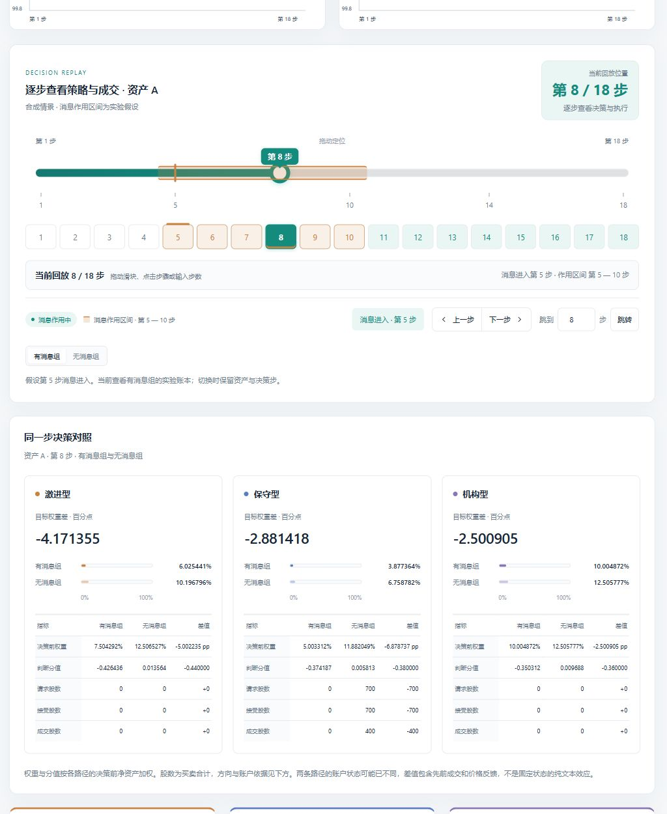

# 平台浏览器流程与响应式布局核验

2026-10-20 至 2026-10-23，使用本机主服务和内置浏览器实际执行参数预览、模型提取、新建、运行、刷新读取、策略变体、比较及下载。执行代码基于 `339cf56`；本轮界面改动限于标题和操作按钮的换行布局。

## 完整操作链路

从策略页将保守型风险预算精确输入为 `0.83%`，带入新实验，使用明确标为“交互验收用合成问答”的文字调用 `DeepSeek-V4-Flash-0731-W8A8`。模型提取三条事实：项目尚未获得正式批复、已提交补充材料、投产日期无法确定；各自引文和字符位置与输入原文一致。

方向、不确定性仍由操作者设定。实际保存的情景为信号 −0.4、不确定性 0.8、持续 6 步、总步数 18、种子 102020、仅资产 A、共同市场偏移 0、日波动率下限 3%。保守型风险预算保存为 `0.0083`，工作区默认值仍为 `0.008`。

| 记录 | 实验编号 | 结果版本 |
| --- | --- | --- |
| 基准 | `11de5ea421d84c348dac3284ddc0c695` | `bf15e4b53ec34c2a95ad25feae78cf85` |
| 激进敏感度变体 | `93c4bf327f3b481298d0b3c870a41527` | `91f150c1a665433f9ca0a23b32b85add` |

分析编号为 `e46457ceb148403fbebdc9fc7aa46596`。基准通过界面保存和运行后，从“调整策略再跑”复制，仅将激进型文本敏感度从 0.9 改为 1.2。两份记录使用相同原文、发布时间、分析快照、情景、种子和机制；各自的两组共 36 个市场日均通过账本审计，合计 72 日。刷新页面和重启服务后可再次读取已完成实验。

## 已核对的交互

| 操作 | 观察结果 |
| --- | --- |
| 回放首尾定位 | Home/End 到第 1/18 步，前后边界按钮正确禁用 |
| 非法步数与精确跳转 | 输入 0 提示错误并保持原步；输入 5 后进入消息作用期 |
| 信息组与资产切换 | 保留已选步数，信息组与资产对应的账本和解释同步更新 |
| 参数精确输入 | `0.83%` 在滑块、数值框、草稿、确认页和导出中保持一致 |
| 参数空值 | 风险预算为空时阻止保存和预览交接，不使用空值生成实验 |
| 发布时间 | 新来源为空且不能继续；复制实验保留明确填写的来源时间 |
| 模型提取 | 实际请求成功；三条事实逐字引文匹配，不改动人工情景参数 |
| 比较与下载 | 比较页识别条件一致及一项参数变化；实际下载的双实验 JSON 与两份固定结果版本匹配 |
| 历史行情回放 | 读取 2020-07-22 至 2020-09-01 的日期，第 5 日为 2020-07-28；切换条件保留日期 |
| 原文案例回放 | 武汉案例消息在登记的第 4 步进入，对应 2020-02-04；切换无文本条件保留第 4 步 |
| 批次读取 | 既有批次显示 12/12 完成、0 失败和 0 中断；本轮未新增批次或注入失败 |
| 参数隔离 | 实验中 `0.83%` 的修改未覆盖工作区的 `0.80%` 默认值 |

三个 Agent 的说明与实现对应：共享 DeepSeek 负责事实提取，三类参数作用于同一本地决策引擎，目标、订单和成交由本地规则与撮合计算。

## 参数变体的实际结果

有消息条件下，24 个“账户 × 步”的判断和目标发生变化。第 5 步激进型在资产 A 的目标差约为 −0.872712 个百分点，四笔卖单限价从 99.38 改为 99.14。两次运行的各步收盘账户、价格、请求量、成交量及最终收益仍一致。无消息条件的判断和目标也一致。

因此本例验证参数确实进入决策和订单计算，同时保留其未改变最终成交与收益的结果。单个种子不证明参数普遍有效或最优，合成文字与市场也不构成真实收益预测实验。

## 布局修复与截图

中等宽度窗口曾将标题压成窄列，并使五个操作按钮越出页面。标题区现可换行，标题保留可用宽度，操作按钮受容器宽度约束并自然折行；重复的按钮换行规则合并到原定义。

390、576、800、1280 像素四种窗口宽度的实际浏览器检查均无整页横向溢出，五个操作按钮均位于标题容器内。576 像素窗口中，修复前标题宽约 102 像素、页面内容宽 723 像素；修复后标题宽 441 像素，页面内容宽与可视区域均为 561 像素。

下面为 10 月 20 日成功捕获的原始浏览器截图，与本轮提交的布局修复对应；图片未重绘或修改。10 月 23 日重新通过 DOM 几何和实际控件操作核对布局，截图接口返回无法捕获，未将失败请求记作新截图。

## 证据与范围

原始截图、交互记录、导出快照和哈希凭据保存在 Git 忽略的 `research_outputs/platform_workspace/validation/browser_20261020/` 与 `browser_20261023/`。前者包含实际模型提取、实验创建和浏览器下载，后者包含服务重启后的读取、比较、来源案例与布局复查。测试脚本对视口复位尺寸和无文本案例审计步数的初始假设及修正均保留。

浏览器记录证明上述操作范围可用。窄屏溢出与容器位置通过实际 DOM 几何核对；本次未重新执行研究全套回归，也未验证所有浏览器、移动设备、故障恢复或生产部署。文档和样式更新未改动仿真规则、冻结配置、归档结果或本机凭据。
